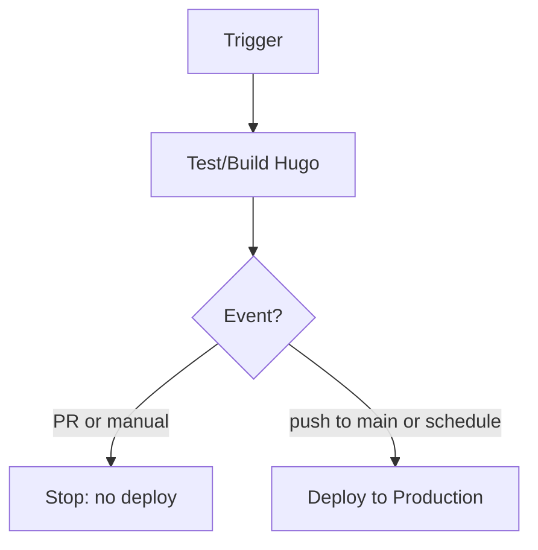

# GitHub Actions Workflows

This directory contains automated workflows for the Support Tools website.

## Workflows

### 1. cloudflare-workers.yml - Cloudflare Workers Deployment

**Purpose**: Deploy the Hugo static site to Cloudflare Workers

**Triggers**:
- **Push to main**: Tests, then deploys to production
- **Pull Request**: Builds and runs the check gates only; never deploys
- **Manual dispatch**: Runs the Test job only (the production deploy does not match dispatch)
- **Schedule**: 06:00, 14:10 and 15:10 UTC daily (picks up scheduled posts), then deploys production

**Deployment Flow**:



**Environments**:
- `production` - https://support.tools (the only one)

The staging, development, mst, qas and tst Workers were retired in Phase 0 of the v2
publishing platform design. `wrangler.toml` sets `workers_dev = false` and
`preview_urls = false`, so no workers.dev or Version URL serves the site either. Previews
move in-cluster on internal DNS in a later phase.

The legacy `pipeline.yml` (Docker image to Kubernetes via Argo CD) was removed along with the
old Go web server.

## Required Secrets

Configure these in Settings → Secrets → Actions:

- `CLOUDFLARE_API_TOKEN` - API token with Workers:Edit permissions

## Usage Examples

### Manual Deployment

1. Go to Actions tab
2. Select "Deploy to Cloudflare Workers"
3. Click "Run workflow"
4. Click "Run workflow" (this runs the Test job; production deploys from `main` and the schedule)

### Automatic Deployments

- **Production**: Push to `main` branch, or a scheduled run
- **Pull requests**: Test only, no deploy

## Monitoring Deployments

### View Logs
```bash
# Real-time logs
wrangler tail --env production

# GitHub Actions logs
gh run list --workflow=cloudflare-workers.yml
gh run view <run-id>
```

### Check Status
```bash
curl -s -o /dev/null -w "%{http_code}\n" https://support.tools
```

## Rollback Procedure

1. **Via GitHub**:
   ```bash
   # List recent deployments
   gh run list --workflow=cloudflare-workers.yml --limit 10
   
   # Re-run a previous successful deployment
   gh run rerun <run-id>
   ```

2. **Via Wrangler**:
   ```bash
   # List versions
   wrangler deployments list
   
   # Rollback to previous version
   wrangler rollback --env production
   ```

## Troubleshooting

### Deployment Fails

1. Check GitHub Actions logs
2. Verify CLOUDFLARE_API_TOKEN is set
3. Check Hugo build output
4. Verify DNS is pointing to Cloudflare

### Site Not Updating

1. Clear Cloudflare cache
2. Check if deployment completed
3. Verify correct environment deployed
4. Check Workers logs: `wrangler tail`

### Performance Issues

1. Check Workers analytics in Cloudflare Dashboard
2. Monitor request duration in logs
3. Verify static assets are cached
4. Check for large unoptimized images

## Migration from Kubernetes

The site has been migrated from Kubernetes to Cloudflare Workers:

- **Old**: Docker → Kubernetes → ArgoCD → Nginx
- **New**: Hugo → Cloudflare Workers → Global CDN

Benefits:
- ✅ Free hosting for static assets
- ✅ Global edge deployment
- ✅ No infrastructure to manage
- ✅ Faster deployment times
- ✅ Better performance