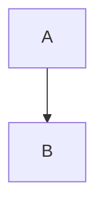

Fixture used by the theme tests. Not published.

<!--more-->

## Shell and YAML

```bash
$ kubectl get pods
NAME        READY   STATUS    RESTARTS   AGE
web-0       1/1     Running   0          3d
# a comment
echo "done" && exit 0
```

```yaml {filename="longhorn-settings.yaml"}
apiVersion: v1
kind: ConfigMap
metadata:
  name: longhorn-default-setting
data:
  replica-count: "3"
  # comment
  enabled: true
```

```yaml {filename="a<b>.yaml"}
key: value
```

## Plain and Go

```
plain text without a language
```

### Go with line numbers

```go {linenos=table}
package main

import "fmt"

func main() {
	fmt.Println("hello", 42)
}
```

```go {linenos=inline}
package main

func add(a, b int) int {
	return a + b // sum
}
```

## Diagram



## Raw HTML

<pre>raw pre block</pre>

## Callouts

> [!NOTE]
> Notes carry supporting context for the surrounding text.

> [!TIP]
> Tips suggest a faster or safer way to do the work.

> [!WARNING]
> Warnings flag steps that can cause an outage if skipped.

> [!CAUTION]
> Cautions render as a note because only three kinds are styled.

> A plain blockquote keeps its markup.
